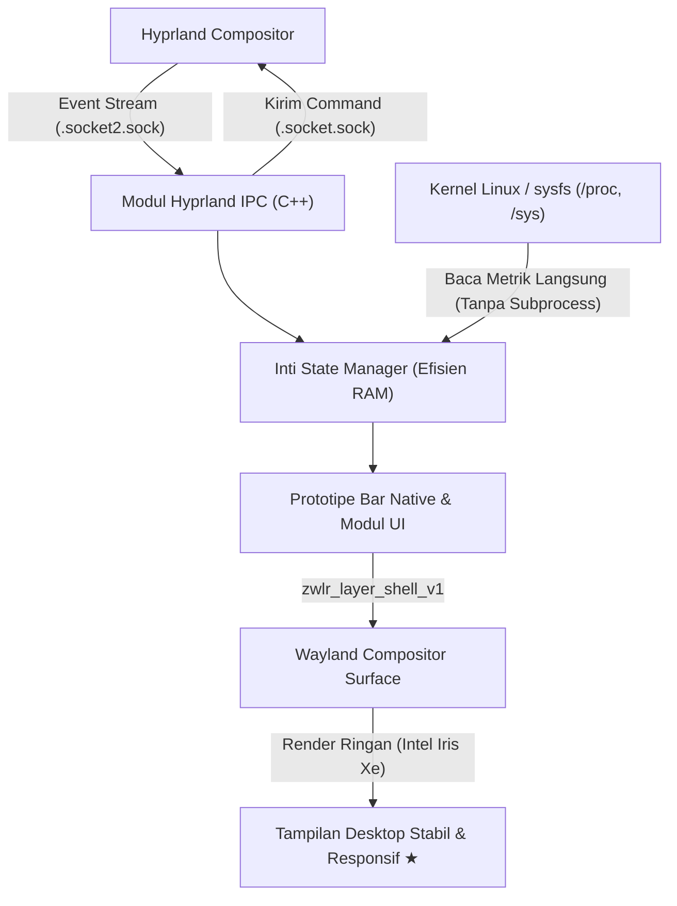

# 🐍 Serpantinum Native

<h6 align="center">
  <pre align="center">
 ______     ______     ______     ______   ______     __   __     ______   __     __   __     __  __     __    __   
/\  ___\   /\  ___\   /\  == \   /\  == \ /\  __ \   /\ "-.\ \   /\__  _\ /\ \   /\ "-.\ \   /\ \/\ \   /\ "-./  \  
\ \___  \  \ \  __\   \ \  __<   \ \  _-/ \ \  __ \  \ \ \-.  \  \/_/\ \/ \ \ \  \ \ \-.  \  \ \ \_\ \  \ \ \-./\ \ 
 \/\_____\  \ \_____\  \ \_\ \_\  \ \_\    \ \_\ \_\  \ \_\\"\_\    \ \_\  \ \_\  \ \_\\"\_\  \ \_____\  \ \_\ \ \_\
  \/_____/   \/_____/   \/_/ /_/   \/_/     \/_/\/_/   \/_/ \/_/     \/_/   \/_/   \/_/ \/_/   \/_____/   \/_/  \/_/

 __   __     ______     ______   __     __   __   ______   
/\ "-.\ \   /\  __ \   /\__  _\ /\ \   /\ \ / /  /\  ___\  
\ \ \-.  \  \ \  __ \  \/_/\ \/ \ \ \  \ \ \'/   \ \  __\  
 \ \_\\"\_\  \ \_\ \_\    \ \_\  \ \_\  \ \__|    \ \_____\
  \/_/ \/_/   \/_/\/_/     \/_/   \/_/   \/_/      \/_____/
  </pre>
</h6>

<p align="center">
  <strong>Proyek shell desktop native berbasis C++ untuk ekosistem CachyOS + Hyprland.</strong><br>
  <em>Dirancang untuk efisiensi RAM ekstrem, komunikasi Hyprland IPC instan, dan kestabilan penuh pada protokol Wayland.</em>
</p>

<p align="center">
  <a href="#"></a>
  <a href="https://cachyos.org/"></a>
  <a href="https://hyprland.org/"></a>
  <a href="https://isocpp.org/"></a>
  <a href="#"></a>
</p>

---

## 📌 Daftar Isi

- [Gambaran Umum](#-gambaran-umum)
- [Masalah vs. Solusi](#-masalah-vs-solusi)
- [Tujuan Proyek](#-tujuan-proyek)
- [Target Perangkat Keras](#-target-perangkat-keras)
- [Pratinjau & Alur Pemantauan (Konsep)](#-pratinjau--alur-pemantauan-konsep)
- [Arsitektur & Cara Kerja (Di Balik Layar)](#-arsitektur--cara-kerja-di-balik-layar)
- [Rencana Pengerjaan (Roadmap)](#-rencana-pengerjaan-roadmap)
- [Prinsip Kestabilan & Mitigasi Risiko](#-prinsip-kestabilan--mitigasi-risiko)
- [Status Proyek Saat Ini](#-status-proyek-saat-ini)
- [Lisensi & Catatan Pengembang](#-lisensi--catatan-pengembang)

---

## 💡 Gambaran Umum

Banyak *desktop shell* modern di ekosistem **Hyprland** mengandalkan *runtime* tingkat tinggi (seperti JavaScript/GJS, Python, QML berat, atau pemanggilan skrip *polling* Bash berulang kali). Meskipun mudah dikustomisasi, pendekatan tersebut sering mengorbankan memori ratusan megabyte dan memicu *CPU wake-up* yang tidak perlu—sangat terasa pada perangkat dengan kapasitas **RAM 8 GB**.

**`Serpantinum Native`** adalah inisiatif rekayasa ulang (*ground-up rewrite*) untuk membangun kembali fitur-fitur *shell* **Serpantinum** secara bertahap menggunakan **C++** dan teknologi **Wayland native**. Proyek ini berfokus pada:

- Eliminasi *overhead* *interpreter* dan *garbage collector*.
- Komunikasi berbasis *event* langsung melalui *socket* **Hyprland IPC** (`$HYPRLAND_INSTANCE_SIGNATURE`).
- Pemanfaatan memori yang sangat hemat tanpa mengorbankan estetika maupun stabilitas lingkungan kerja harian.

---

## ⚖️ Masalah vs. Solusi

| Aspek Teknis | Shell Berbasis Skrip + Polling | Framework Web / Interpreter Berat | `Serpantinum Native` 🚀 |
| :--- | :---: | :---: | :---: |
| **Bahasa & Runtime** | Bash / Python + Subprocess | JS (GJS) / Electron / QML | **Native C++ Binary** |
| **Jejak Penggunaan RAM** | ⚠️ Sedang (bocor saat *spawn* proses) | ❌ Tinggi (150 MB – 400 MB+) | ✅ **Ultra-Rendah (Target < 15–30 MB)** |
| **Komunikasi Hyprland** | ❌ Polling `hyprctl` berkala | ⚠️ Wrapper pihak ketiga | ✅ **Koneksi Socket UNIX IPC Langsung** |
| **Protokol Rendering** | ⚠️ Bergantung alat eksternal | ⚠️ Abstraksi berlapis | ✅ **Wayland Layer-Shell Native** |
| **Dampak pada Sistem 8 GB** | ⚠️ Menyisakan ruang sempit saat beban berat | ❌ Memicu *swap* / *OOM pressure* | ✅ **Ramah *Multitasking* & Ringan** |
| **Kestabilan Konfigurasi Utama** | ⚠️ Rawan *break* saat eksperimen | ⚠️ Kompleksitas dependensi | ✅ **Isolasi penuh & migrasi bertahap** |

---

## 🎯 Tujuan Proyek

- **🧱 Rekonstruksi Bertahap (*Incremental Rebuild*):** Membangun ulang fitur-fitur *shell* Serpantinum satu per satu secara terukur tanpa merusak alur kerja yang sudah berjalan.
- **🧠 Eksplorasi Mendalam C++ & Wayland:** Mempelajari praktik terbaik pemrograman sistem menggunakan **C++** modern serta protokol desktop **Wayland** (`wlr-layer-shell`, manajemen *surface*, dan *event loop*).
- **⚡ Efisiensi Memori sebagai Prioritas Utama:** Mengutamakan penggunaan RAM seminimal mungkin agar sistem 8 GB tetap responsif untuk kompilasi, peramban, dan aplikasi utama.
- **🛡️ Menjaga Kestabilan Desktop:** Memastikan lingkungan desktop harian di CachyOS + Hyprland tetap stabil seratus persen selama masa transisi dan pengembangan.

---

## 💻 Target Perangkat Keras

Seluruh optimasi kompilasi, manajemen memori, dan *rendering pipeline* pada proyek ini dirancang khusus dan diuji langsung pada spesifikasi berikut:

| Komponen | Spesifikasi Target | Fokus Optimasi |
| :--- | :--- | :--- |
| **Sistem Operasi** | **CachyOS Linux** | Kernel teroptimasi (`linux-cachyos`), *sched-ext*, & paket *x86-64-v3/v4* |
| **Compositor** | **Hyprland** (Wayland) | Integrasi *UNIX domain socket* IPC (`.socket.sock` & `.socket2.sock`) |
| **Prosesor (CPU)** | **Intel Core i5-1135G7** (4C/8T @ 4.20 GHz) | Minimasi *context switching* & penghindaran *busy-loop polling* |
| **Memori (RAM)** | **8 GB** | Manajemen alokasi ketat, *zero-bloat*, pencegahan *memory leak* |
| **Grafis (GPU)** | **Intel Iris Xe Graphics** | Rendering *hardware-accelerated* / *buffer sharing* yang hemat VRAM |

---

## 🖥️ Pratinjau & Alur Pemantauan (Konsep)

### 1. Audit Fitur & Pengukuran Baseline RAM (Tahap 1–2)

```text
$ serpantinum-bench --baseline

[SERPANTINUM NATIVE — MEMORY & FEATURE AUDITOR]
-------------------------------------------------------------------------
Target Host : CachyOS Linux (x86_64) | Hyprland Compositor
Hardware    : Intel Core i5-1135G7 | 8 GB RAM | Intel Iris Xe
-------------------------------------------------------------------------

[*] Memindai komponen aktif Serpantinum saat ini...
    MODULE              CURRENT BACKEND       RSS MEMORY    POLL RATE
    ---------------------------------------------------------------------
    Status Bar          Legacy Shell          ~85.4 MB      Event + 2s
    Workspace Daemon    Script Wrapper        ~24.1 MB      Subprocess
    System Tray / OSD   External Widget       ~62.8 MB      Idle
    ---------------------------------------------------------------------
    Total Penggunaan RAM Shell Saat Ini : ~172.3 MB
    Target Penggunaan Serpantinum Native: < 25.0 MB (Penghematan ~85%)

[★] Baseline tersimpan. Siap memulai prototipe bar native (Tahap 3).
```

### 2. Integrasi Hyprland IPC Socket (Tahap 4)

```text
$ ./serpantinum-bar --debug-ipc

[SERPANTINUM-NATIVE v0.1.0-alpha]
[+] Terhubung ke Wayland Display : wayland-1
[+] Mengikat layer surface       : zwlr_layer_shell_v1 (TOP, Anchor: LEFT|RIGHT|TOP)
[+] Membuka Hyprland Event Socket: $XDG_RUNTIME_DIR/hypr/.../.socket2.sock

[IPC EVENT] >> workspace>>2
[IPC EVENT] >> activewindow>>kitty,serpantinum-native — zsh
[MEM STATS] >> RSS: 8.42 MB | Heap: 1.15 MB | CPU: 0.0% (Event-Driven Idle)
```

---

## 🔍 Arsitektur & Cara Kerja (Di Balik Layar)



1. **Audit & Pemetaan Fitur:** Menginventarisasi seluruh fungsi dari *shell* Serpantinum lama untuk menentukan modul mana yang paling banyak mengonsumsi memori.
2. **Pengukuran Metrik Awal (*Baseline*):** Mencatat jejak penggunaan RAM (*Resident Set Size* / `PSS`) sebelum baris kode pertama diaktifkan pada sesi utama.
3. **Koneksi Socket Langsung:** Alih-alih memanggil `hyprctl` berulang kali melalui *shell*, program membaca langsung *stream* dari `$XDG_RUNTIME_DIR/hypr/$HYPRLAND_INSTANCE_SIGNATURE/.socket2.sock`.
4. **Pembacaan Sistem Tanpa Subproses:** Informasi baterai, memori, dan CPU dibaca langsung melalui berkas virtual `/proc` dan `/sys` menggunakan pustaka standar C++.
5. **Integrasi Bertahap:** Setiap fitur yang selesai diuji di lingkungan terisolasi akan menggantikan komponen lama satu per satu tanpa mengganggu sesi Hyprland aktif.

---

## 🗺️ Rencana Pengerjaan (Roadmap)

Pengembangan dilakukan secara berurutan melalui 6 tahapan terstruktur:

- [ ] **Tahap 1 — Audit Fitur Serpantinum**
  - Mendata seluruh komponen UI, *keybind*, indikator sistem, dan perilaku modul yang ada saat ini.
  - Memisahkan fitur esensial (*core*) dari fitur tambahan (*nice-to-have*).
- [ ] **Tahap 2 — Mengukur Penggunaan RAM Awal**
  - Mencatat penggunaan memori (`PSS`/`RSS`) dari konfigurasi *shell* saat ini sebagai patokan pembanding (*benchmark*).
- [ ] **Tahap 3 — Membuat Prototipe Bar Native**
  - Menginisialisasi proyek C++ dan membangun jendela *status bar* dasar di atas protokol Wayland (*layer-shell*).
- [ ] **Tahap 4 — Mengintegrasikan Hyprland IPC**
  - Menghubungkan *bar* native dengan *socket* Hyprland untuk menampilkan *workspace* aktif dan judul jendela secara *real-time*.
- [ ] **Tahap 5 — Menambahkan Fitur Secara Bertahap**
  - Memigrasikan modul jam, indikator sistem (RAM/CPU/Baterai/Audio), dan komponen Serpantinum lainnya satu per satu.
- [ ] **Tahap 6 — Menguji dan Mengoptimalkan Performa**
  - Melakukan *profiling* memori (Valgrind / AddressSanitizer), memangkas alokasi berlebih, dan memvalidasi kestabilan jangka panjang.

---

## 🛡️ Prinsip Kestabilan & Mitigasi Risiko

Mengingat proyek ini ditujukan untuk perangkat kerja utama, pengembangan **Serpantinum Native** mematuhi aturan keamanan berikut:

- 🔒 **Zero-Breakage Policy:** Konfigurasi `hyprland.conf` yang sedang berjalan **tidak akan diubah** sampai prototipe native terbukti stabil di sesi pengujian mandiri.
- 🧪 **Pengujian Terisolasi:** Setiap komponen baru diuji sebagai proses terpisah yang dapat dihentikan kapan saja tanpa menjatuhkan *compositor* Hyprland.
- 📉 **Anggaran Memori Ketat:** Setiap penambahan fitur baru wajib melewati pengecekan penggunaan RAM agar tidak menyimpang dari tujuan efisiensi pada sistem 8 GB.

---

## 📊 Status Proyek Saat Ini

> **🚧 Status: Tahap 0 — Persiapan Proyek**
>
> - Repositori dan kerangka rencana pengerjaan telah disiapkan.
> - **Belum ada perubahan pada konfigurasi Hyprland.** Sistem masih menjalankan konfigurasi stabil saat ini sembari mempersiapkan **Tahap 1 (Audit Fitur Serpantinum)**.

---

## 📜 Lisensi & Catatan Pengembang

Proyek ini dikembangkan sebagai sarana pembelajaran **C++** dan **teknologi desktop Wayland**, sekaligus solusi nyata untuk menciptakan *desktop shell* yang sangat ringan di atas **CachyOS + Hyprland**.

---

<p align="center">
  <sub>Dibangun dengan fokus pada efisiensi memori dan kestabilan desktop.</sub>
</p>
